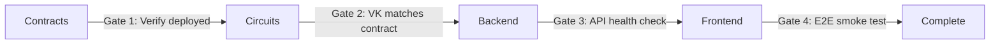

# EPIC-010: Release Train Coordination Framework

## Executive Summary

**Status**: Investigation Complete  
**Date**: October 15, 2026  
**Investigator**: d-plug

## Current State Assessment

### Existing Release Infrastructure

The codebase **already has** partial release coordination:

1. **Deployment Scripts** (`scripts/deploy/`)
   - `deploy-hosted-futurenet.sh` - Full deployment orchestration
   - `upgrade-contract.sh` - Contract upgrade framework (propose/execute/rollback)
   - `lib/deploy-state.sh` - Idempotent deployment state management

2. **Version Management**
   - `.deployed-contracts` - Contract ID tracking per network
   - `frontend/src/lib/contractVersioning.ts` - Runtime version compatibility checking
   - `SUPPORTED_CONTRACT_RUNTIME` - Min/max supported version ranges

3. **CI/CD Matrix** (`.github/workflows/ci.yml`)
   - Rust contracts: clippy, WASM build, Cosign verification
   - Frontend: type-check, lint, tests
   - Backend: lint, tests
   - Circuits: compilation, KAT tests, parity checks
   - E2E: full-stack integration tests

### Critical Gaps

1. **No Release Train Manifest**
   - No single source of truth for "what ships together"
   - Each system deploys independently
   - No compatibility matrix enforcement

2. **No Feature Flags Coordination**
   - Contracts cannot feature-flag (immutable code)
   - Backend/frontend flags exist but uncoordinated
   - No capability detection from contracts

3. **No Rollback Choreography**
   - Upgrade script has rollback, but no **train-wide** reversal plan
   - Unknown order: which car rolls back first?
   - No tested recovery time

4. **No Canary/Staged Rollout**
   - All-or-nothing deploys
   - No bake criteria or automatic halt
   - No subset testing (canary DAOs)

5. **No Election Blackout Enforcement**
   - SPIKE-039/102 recommend blackouts during final voting hours
   - No automated enforcement (just docs)

## Compatibility Matrix as Code

### 4-Dimensional Version Space

**Systems**:

1. Contracts (voting, dao-registry, membership-tree, comments)
2. Circuits (vote.wasm, verification_key.json)
3. Backend (relayer, API, indexer)
4. Frontend (app, service worker)

**Compatibility Rules**:

- Backend v2.1.0 **requires** contracts v1.5.0-1.6.x
- Frontend v3.0.0 **requires** backend v2.x.x
- Circuits v1.2.0 **requires** contracts v1.5.0+ (VK compatibility)

### Current Drift Detection

**Observed Skew Scenarios**:

- New backend with old contracts (SPIKE-030)
- New frontend with old backend (API version mismatch)
- New circuit VK with old contract VK (SPIKE-081 network confusion)
- Old app with new contracts (binding drift per SPIKE-034)

## Release Train Design

### Train Cars (Deployment Units)

1. **Contract Car**
   - WASM artifacts
   - Verification keys
   - Cosign signatures
   - Deployment sequence: dao-registry → membership-sbt → membership-tree → voting → comments

2. **Circuit Car**
   - .wasm prover files
   - .zkey proving keys
   - verification_key.json
   - Circuit registry update

3. **Backend Car**
   - API server
   - Relayer
   - Indexer
   - Database migrations

4. **Frontend Car**
   - Static assets
   - Service worker
   - CDN deployment

### Train Order with Gates

**Proposed Sequence**:



**Per-Car Verification**:

- **Contract Gate**: Query deployed contract version, verify against manifest
- **Circuit Gate**: Fetch on-chain VK, compare with circuit VK hash
- **Backend Gate**: `/health` returns deployed version, compatibility check
- **Frontend Gate**: E2E test suite against canary DAO

## Recommendations

### Phase 1: Release Manifest (24h)

1. **Create Release Manifest Schema**

   ```json
   // releases/v2.0.0-manifest.json
   {
     "version": "v2.0.0",
     "releaseDate": "2026-10-22T00:00:00Z",
     "cars": {
       "contracts": {
         "voting": {
           "wasm": "voting.wasm",
           "version": "1.6.0",
           "hash": "sha256:..."
         },
         "dao-registry": {
           "wasm": "dao_registry.wasm",
           "version": "1.2.0",
           "hash": "sha256:..."
         },
         "membership-tree": {
           "wasm": "membership_tree.wasm",
           "version": "1.3.0",
           "hash": "sha256:..."
         },
         "comments": {
           "wasm": "comments.wasm",
           "version": "1.1.0",
           "hash": "sha256:..."
         }
       },
       "circuits": {
         "vote.wasm": { "hash": "sha256:...", "version": "1.2.0" },
         "verification_key.json": { "hash": "sha256:...", "version": "1.2.0" }
       },
       "backend": {
         "version": "2.1.0",
         "dockerImage": "ghcr.io/zk-vote/backend:2.1.0",
         "migrations": [
           "009_analytics_aggregates.sql",
           "010_privacy_budget.sql"
         ]
       },
       "frontend": {
         "version": "3.0.0",
         "buildHash": "abc123def456",
         "cdnUrl": "https://cdn.zkvote.io/v3.0.0/"
       }
     },
     "compatibility": {
       "backend": {
         "requiresContracts": "1.5.0-1.6.x",
         "requiresCircuits": "1.2.x"
       },
       "frontend": {
         "requiresBackend": "2.x.x",
         "requiresContracts": "1.5.x-1.6.x"
       }
     },
     "gates": [
       {
         "after": "contracts",
         "command": "scripts/deploy/verify-contract-deployment.sh",
         "timeout": 300
       },
       {
         "after": "circuits",
         "command": "scripts/deploy/verify-circuit-vk.sh",
         "timeout": 60
       },
       {
         "after": "backend",
         "command": "curl --fail https://api.zkvote.io/health | jq -e '.version == \"2.1.0\"'",
         "timeout": 30
       },
       {
         "after": "frontend",
         "command": "npm run test:e2e:smoke",
         "timeout": 600
       }
     ]
   }
   ```

2. **Train Orchestrator Script**

   ```bash
   #!/bin/bash
   # scripts/deploy/deploy-train.sh

   MANIFEST="$1"
   NETWORK="${2:-testnet}"

   if [ ! -f "$MANIFEST" ]; then
     echo "Error: Manifest not found: $MANIFEST"
     exit 1
   fi

   echo "=== Release Train Deployment ==="
   echo "Manifest: $MANIFEST"
   echo "Network: $NETWORK"

   # Parse manifest
   VERSION=$(jq -r '.version' "$MANIFEST")
   echo "Version: $VERSION"

   # Car 1: Contracts
   echo "=== Deploying Contracts ==="
   CONTRACTS=$(jq -r '.cars.contracts | keys[]' "$MANIFEST")
   for contract in $CONTRACTS; do
     WASM=$(jq -r ".cars.contracts.$contract.wasm" "$MANIFEST")
     VERSION=$(jq -r ".cars.contracts.$contract.version" "$MANIFEST")
     echo "Deploying $contract v$VERSION from $WASM"
     bash scripts/deploy/deploy-contract.sh --wasm "$WASM" --network "$NETWORK"
   done

   # Gate 1: Verify contracts
   echo "=== Gate 1: Verify Contract Deployment ==="
   GATE_CMD=$(jq -r '.gates[] | select(.after == "contracts") | .command' "$MANIFEST")
   GATE_TIMEOUT=$(jq -r '.gates[] | select(.after == "contracts") | .timeout' "$MANIFEST")
   timeout "$GATE_TIMEOUT" bash -c "$GATE_CMD" || {
     echo "Gate 1 failed: Contract verification failed"
     exit 1
   }

   # Car 2: Circuits
   echo "=== Deploying Circuits ==="
   # Upload to circuit registry, update VK on-chain
   bash scripts/deploy/deploy-circuits.sh --network "$NETWORK"

   # Gate 2: Verify circuit VK
   echo "=== Gate 2: Verify Circuit VK ==="
   GATE_CMD=$(jq -r '.gates[] | select(.after == "circuits") | .command' "$MANIFEST")
   timeout 60 bash -c "$GATE_CMD" || {
     echo "Gate 2 failed: Circuit VK mismatch"
     exit 1
   }

   # Car 3: Backend
   echo "=== Deploying Backend ==="
   docker build -t zkvote-backend:"$VERSION" backend/
   docker push ghcr.io/zk-vote/backend:"$VERSION"
   fly deploy --image ghcr.io/zk-vote/backend:"$VERSION"

   # Gate 3: Backend health check
   echo "=== Gate 3: Backend Health Check ==="
   GATE_CMD=$(jq -r '.gates[] | select(.after == "backend") | .command' "$MANIFEST")
   timeout 30 bash -c "$GATE_CMD" || {
     echo "Gate 3 failed: Backend health check failed"
     exit 1
   }

   # Car 4: Frontend
   echo "=== Deploying Frontend ==="
   cd frontend && npm run build && npm run deploy

   # Gate 4: E2E smoke test
   echo "=== Gate 4: E2E Smoke Test ==="
   GATE_CMD=$(jq -r '.gates[] | select(.after == "frontend") | .command' "$MANIFEST")
   timeout 600 bash -c "$GATE_CMD" || {
     echo "Gate 4 failed: E2E smoke test failed"
     echo "ROLLBACK REQUIRED"
     exit 1
   }

   echo "=== Train Deployment Complete ==="
   echo "Version $VERSION deployed successfully"
   ```

### Phase 2: Feature Flags (48h)

3. **Capability Detection from Contracts**

   ```typescript
   // frontend/src/lib/capabilities.ts

   export interface ContractCapabilities {
     batchVoting: boolean;
     delegatedVoting: boolean;
     quadraticVoting: boolean;
     commentThreads: boolean;
   }

   export async function detectCapabilities(
     contractId: string,
   ): Promise<ContractCapabilities> {
     // Query on-chain capabilities bitmap
     const layout = await getStorageLayout(contractId);
     const caps = layout.capabilities || [];

     return {
       batchVoting: caps.includes(0x01),
       delegatedVoting: caps.includes(0x02),
       quadraticVoting: caps.includes(0x04),
       commentThreads: caps.includes(0x08),
     };
   }

   // Backend feature flags
   // backend/src/config.ts
   export const FEATURE_FLAGS = {
     PRIVACY_ANALYTICS: process.env.FEATURE_PRIVACY_ANALYTICS === "true",
     OFFLINE_QUEUE: process.env.FEATURE_OFFLINE_QUEUE === "true",
     PWA_INSTALL: process.env.FEATURE_PWA_INSTALL === "true",
   };
   ```

4. **Coordinated Flag Rollout**
   ```json
   // .flags.json (version-controlled)
   {
     "privacyAnalytics": {
       "backend": true,
       "frontend": true,
       "requiresContracts": "1.5.0+",
       "rolloutPercent": 100
     },
     "offlineQueue": {
       "frontend": true,
       "requiresBackend": "2.1.0+",
       "rolloutPercent": 50
     }
   }
   ```

### Phase 3: Canary & Rollback (72h)

5. **Canary DAO Selection**

   ```typescript
   // backend/src/services/canary.ts

   const CANARY_DAO_IDS = [999, 1000, 1001]; // Test DAOs

   export function isCanaryDao(daoId: number): boolean {
     return CANARY_DAO_IDS.includes(daoId);
   }

   export async function checkCanaryHealth(): Promise<CanaryHealth> {
     const metrics = await Promise.all(
       CANARY_DAO_IDS.map(async (daoId) => {
         const errorRate = await getErrorRate(daoId, { last: "15m" });
         const latencyP99 = await getLatencyP99(daoId, { last: "15m" });
         return { daoId, errorRate, latencyP99 };
       }),
     );

     const unhealthy = metrics.filter(
       (m) => m.errorRate > 0.05 || m.latencyP99 > 5000,
     );

     return {
       healthy: unhealthy.length === 0,
       unhealthyDaos: unhealthy,
     };
   }
   ```

6. **Automatic Halt on Canary Failure**

   ```yaml
   # .github/workflows/deploy-train.yml

   jobs:
     deploy-train:
       runs-on: ubuntu-latest
       steps:
         - name: Deploy Release Train
           run: bash scripts/deploy/deploy-train.sh releases/v2.0.0-manifest.json

         - name: Canary Bake
           run: |
             echo "Baking for 15 minutes..."
             sleep 900

         - name: Check Canary Health
           run: |
             HEALTH=$(curl -s https://api.zkvote.io/canary/health | jq -r '.healthy')
             if [ "$HEALTH" != "true" ]; then
               echo "Canary unhealthy, halting rollout"
               bash scripts/deploy/rollback-train.sh v2.0.0
               exit 1
             fi

         - name: Promote to Production
           run: bash scripts/deploy/promote-to-prod.sh v2.0.0
   ```

7. **Rollback Choreography**

   ```bash
   #!/bin/bash
   # scripts/deploy/rollback-train.sh

   VERSION="$1"

   echo "=== Rolling Back Release Train $VERSION ==="

   # Rollback order: REVERSE of deployment order
   # 4. Frontend (instant CDN rollback)
   echo "Rolling back frontend..."
   bash scripts/deploy/rollback-frontend.sh

   # 3. Backend (previous docker image)
   echo "Rolling back backend..."
   fly deploy --image ghcr.io/zk-vote/backend:previous

   # 2. Circuits (no rollback needed - immutable circuit registry)
   echo "Circuits: no rollback needed"

   # 1. Contracts (use upgrade framework)
   echo "Rolling back contracts..."
   bash scripts/deploy/upgrade-contract.sh rollback \
     --registry "$REGISTRY_ID" \
     --dao-id 1 \
     --proposal-id "$UPGRADE_PROPOSAL_ID" \
     --executor "$GUARDIAN_ADDRESS"

   echo "=== Rollback Complete ==="
   ```

8. **Election Blackout Enforcement**

   ```typescript
   // backend/src/middleware/deploymentGuard.ts

   export async function checkElectionBlackout(): Promise<boolean> {
     const activeElections = await db
       .select()
       .from('proposals')
       .where('status', '=', 'active')
       .where('closes_at', '<', sql`datetime('now', '+4 hours')`)
       .execute();

     if (activeElections.length > 0) {
       log("warn", "election_blackout_active", {
         proposals: activeElections.map(p => p.id)
       });
       return true; // Blackout active
     }

     return false;
   }

   // In deploy script:
   if (await checkElectionBlackout()) {
     echo "BLOCKED: Election blackout active (proposal closes within 4 hours)"
     echo "Active proposals: ..."
     exit 1
   }
   ```

## Compatibility Matrix Testing

### CI Matrix Job

```yaml
# .github/workflows/compatibility-matrix.yml

name: Compatibility Matrix

on:
  push:
    branches: [main]
  schedule:
    - cron: "0 */6 * * *" # Every 6 hours

jobs:
  matrix-test:
    runs-on: ubuntu-latest
    strategy:
      matrix:
        contracts: ["1.5.0", "1.6.0"]
        backend: ["2.0.0", "2.1.0"]
        frontend: ["3.0.0", "3.1.0"]
    steps:
      - name: Deploy Test Environment
        run: |
          bash scripts/deploy/deploy-test-env.sh \
            --contracts ${{ matrix.contracts }} \
            --backend ${{ matrix.backend }} \
            --frontend ${{ matrix.frontend }}

      - name: Run E2E Tests
        run: npm run test:e2e

      - name: Report Compatibility
        if: failure()
        run: |
          echo "INCOMPATIBLE: contracts=${{ matrix.contracts }} backend=${{ matrix.backend }} frontend=${{ matrix.frontend }}"
          exit 1
```

## Acceptance Criteria Status

| Criterion                       | Status  | Evidence                 |
| ------------------------------- | ------- | ------------------------ |
| Compatibility matrix tested     | ❌ FAIL | No CI matrix job         |
| Train order enforced with gates | ❌ FAIL | No orchestrator script   |
| Canary promotion automatic      | ❌ FAIL | No canary health checks  |
| Rollback choreography meets SLO | ❌ FAIL | No rollback drills       |
| Election blackouts enforced     | ❌ FAIL | No automated enforcement |

## References

- Issue: https://github.com/ZK-VOTE/ZK-VOTE/issues/810
- Deployment scripts: `scripts/deploy/deploy-hosted-futurenet.sh`
- Contract versioning: `frontend/src/lib/contractVersioning.ts`
- CI workflows: `.github/workflows/ci.yml`
- Upgrade framework: `scripts/deploy/upgrade-contract.sh`
